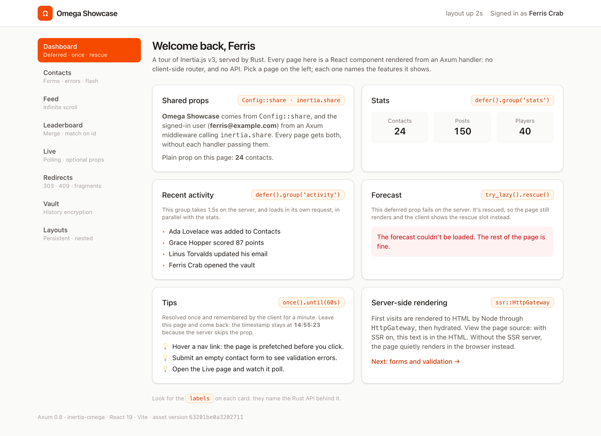
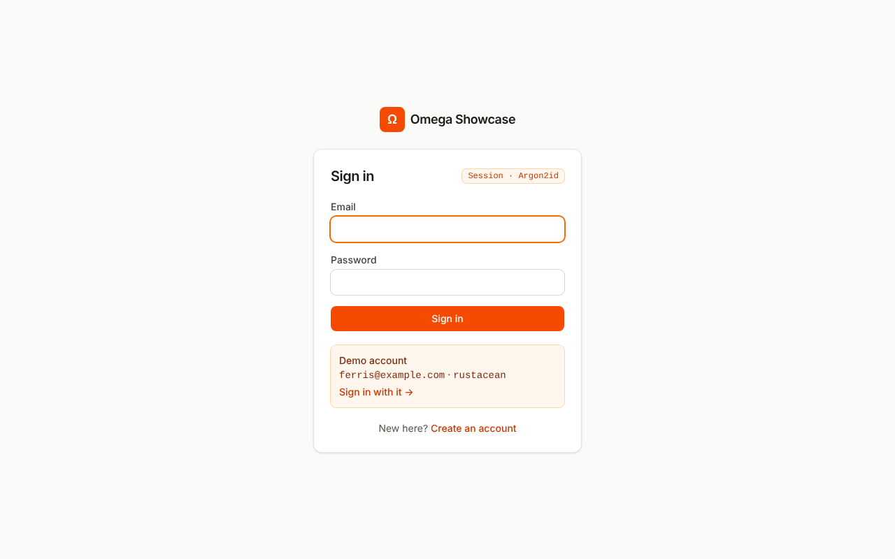
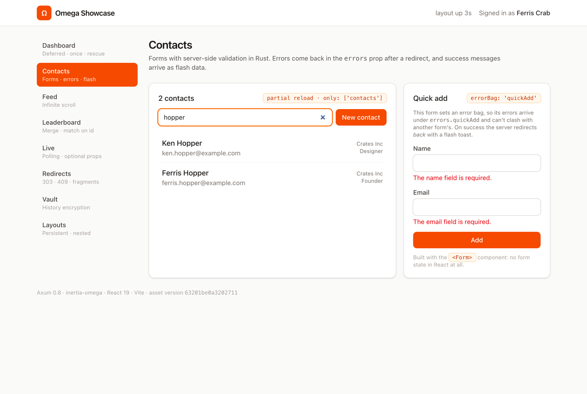
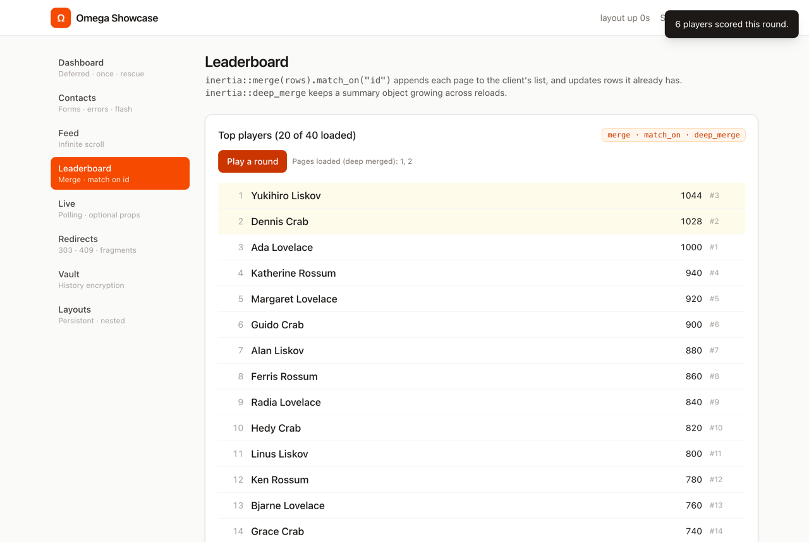
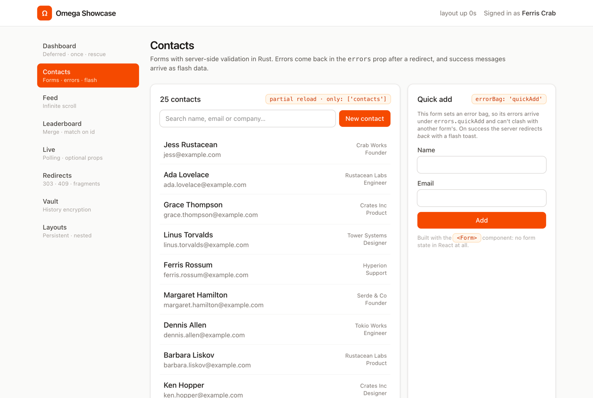

# Omega Showcase

[](https://github.com/kwe/inertia-omega-showcase/actions/workflows/ci.yml)

A small, complete [Inertia.js](https://inertiajs.com) v3 app with a Rust backend. Axum handles every route and returns a page component with its props; React renders it. There's no client-side router and no JSON API to maintain.

The server side is [inertia-omega](https://github.com/inertiajs/inertia-omega), the Rust port of the official Laravel adapter. This app tries to touch as much of it as it reasonably can, one page per group of features.

| | |
| --- | --- |
| Backend | Axum 0.8, [inertia-omega](https://github.com/inertiajs/inertia-omega) (pinned to `6667d8d`), tower-sessions, argon2 |
| Frontend | React 19, `@inertiajs/react` 3.9, TypeScript, Tailwind CSS 4 |
| Build | Vite 8 with `@inertiajs/vite` (page resolution and SSR) |
| Data | Seeded in memory on startup, so there's nothing to set up. Restarting resets it, accounts included. |



<table>
  <tr>
    <td></td>
    <td></td>
    <td></td>
    <td></td>
  </tr>
  <tr>
    <td align="center">Sign in: sessions and Argon2id</td>
    <td align="center">Contacts: partial reloads and error bags</td>
    <td align="center">Leaderboard: merge props</td>
    <td align="center">SSR with JavaScript off</td>
  </tr>
</table>

## Running it

You need Rust 1.88 or newer and Node 20.19 or newer.

```bash
npm install
```

### Development

Two terminals:

```bash
npm run dev     # Vite on :5173, with hot reload and SSR
cargo run       # the app on http://127.0.0.1:3000
```

Open http://127.0.0.1:3000 (the Rust server, not Vite) and sign in with the demo account, `ferris@example.com` / `rustacean`, or register your own. While Vite runs, it writes its URL to `public/hot`. The Rust server sees that file, points the asset tags at the dev server, and renders pages server-side through Vite's `/__inertia_ssr` endpoint, so there's no separate SSR process in development.

### Production build

```bash
npm run build   # typecheck, client bundle in public/build, SSR bundle in bootstrap/ssr
npm run ssr     # the Node SSR server on :13714 (optional)
cargo run --release
```

If the SSR server isn't running, pages render in the browser instead; nothing else changes.

### Tests

```bash
cargo test
```

`tests/app.rs` drives the router directly with `tower::ServiceExt::oneshot` and checks each feature at the protocol level with inertia-omega's `AssertablePage`: deferred groups, rescued props, error bags in the session, flash data, 303s, 409s, scroll and merge metadata, sign-in and sign-out, and so on. Most tests sign in as the demo user first; `guest()` gives a signed-out app.

### Continuous integration

`.github/workflows/ci.yml` runs on every push to `main` and every pull request, in two jobs:

- **Rust:** `cargo fmt --check`, `cargo clippy --all-targets -- -D warnings`, `cargo test` and a release build.
- **Frontend:** `npm ci` and `npm run build`, which typechecks with `tsc` and builds both the client bundle and the SSR bundle.

## What each page shows

Each card in the app has a small orange label naming the Rust API behind it.

| Page | Inertia features | Where to look |
| --- | --- | --- |
| **Sign in / Register** `/login`, `/register` | Session authentication: `auth.user` shared from middleware (`inertia.share`), guests redirected to `/login` and back to the page they wanted, a page-level layout (`Login.layout = GuestLayout`), `<Form resetOnError>` to clear the password after a failed attempt, and `router.post` for the one-click demo sign-in. Signing out clears the browser history (`inertia.clear_history()`) and the prefetch cache (`router.flushAll()`). | `src/auth.rs`, `src/routes/auth.rs`, `pages/Auth/` |
| **Dashboard** `/` | Shared props from `Config::share` and from middleware (`inertia.share`); deferred props in two parallel groups (`defer().group(..)`) with `<Deferred>`; a failing deferred prop that's rescued (`try_lazy().rescue()`) and shown in `<Deferred rescue>`; a once prop the client remembers for 60s (`once().until(..)`); SSR | `src/routes/dashboard.rs`, `src/lib.rs`, `pages/Dashboard.tsx` |
| **Contacts** `/contacts` | Partial reloads (`only: ['contacts', 'filters']`) for live search with `preserveState`; link prefetching on hover and on mount (`prefetch="mount"`); the `<Form>` component; error bags (`errorBag="quickAdd"`) | `src/routes/contacts.rs`, `pages/Contacts/Index.tsx` |
| **New / Edit contact** | Server-side validation with `ValidationErrors` and `with_errors`, then a redirect to a known route; flash messages (`inertia.flash`) shown as a toast; `redirect` after `POST`; `useForm` with `isDirty`/`recentlySuccessful`; `PUT` and `DELETE` redirects turned into `303 See Other` | `pages/Contacts/Create.tsx`, `pages/Contacts/Edit.tsx`, `pages/Contacts/Show.tsx` |
| **Feed** `/feed` | Infinite scroll: `inertia::scroll_with` + `Paginator`, rendered by `<InfiniteScroll>`. The URL tracks the page as you scroll. | `src/routes/feed.rs`, `pages/Feed.tsx` |
| **Leaderboard** `/leaderboard` | Merge props (`merge().match_on("id")`): "Load more" appends pages; "Play a round" reloads every visible row and updates them in place instead of duplicating them. Deep merge (`deep_merge`) for a summary object. `only` on a `POST` visit. | `src/routes/leaderboard.rs`, `pages/Leaderboard.tsx` |
| **Live** `/live` | Polling (`usePoll` with `only: ['metrics']`, pausable); lazy props computed only when requested (`inertia::lazy`); `always` props sent on every partial reload; an optional prop (`inertia::optional`) fetched by `<WhenVisible>` when you scroll to it | `src/routes/live.rs`, `pages/Live.tsx` |
| **Redirects** `/redirects` | Every redirect rule of the protocol: a `302` after `POST`, `PUT` → `303`, redirect to a `#fragment` (`409` + `X-Inertia-Redirect`), an empty `200` turned into a redirect back, and an external `inertia.location(..)` (`409` + `X-Inertia-Location`) | `src/routes/redirects.rs`, `pages/Redirects.tsx` |
| **Vault** `/vault` | History encryption (`.encrypt_history(true)`) and `inertia.clear_history()` on "lock", as signing out does | `src/routes/vault.rs`, `pages/Vault.tsx` |
| **Layouts** `/layouts` | Persistent layouts: `AppLayout` is the default for every page (the `layout` option in `app.tsx`), and its "layout up Ns" clock keeps counting across visits. These two pages nest a second persistent layout (`Page.layout = [AppLayout, SectionLayout]`) whose text input survives navigation. | `layouts/`, `pages/Layouts/` |
| **Any other URL** | Error pages are Inertia pages with a status code: `(StatusCode::NOT_FOUND, inertia.render("Error", ..))` from the router's fallback | `src/routes/errors.rs`, `pages/Error.tsx` |

And across the whole app:

- **Asset versioning.** The version is a hash of Vite's build manifest (`Config::version_with`, in `src/vite.rs`). To see it work: open the app from a production build, change a page, run `npm run build`, then hover or click a link in the open tab. The server answers `409` with `X-Inertia-Location`, and the browser does a full reload to pick up the new assets. The current version is in the footer. In development it's `dev`, since Vite serves the latest code anyway.
- **Server-side rendering.** `HttpGateway` with a hot file for development and a bundle check for production. View the page source to see the rendered HTML.
- **Progress indicator.** The bar at the top of the page during slow visits (`progress` in `app.tsx`).
- **Page titles.** `<Head title>` plus the `title` callback in `app.tsx`, rendered on the server too.
- **TypeScript types for shared props and flash data.** `resources/js/types.ts` extends `InertiaConfig`, so `usePage().props.auth` and `usePage().flash.toast` are typed.

## Performance

Measured on an Apple M4 Mac mini (10 cores) against a release build and the production bundle, with `hey` at 50 connections for 8 seconds per route, on the same machine.

| Route | Full page with SSR (req/s, p50 / p99) | Inertia visit, JSON (req/s, p50 / p99) |
| --- | --- | --- |
| `/` | 2,440, 18 / 66 ms | 56,800, 0.8 / 2.2 ms |
| `/contacts` | 1,030, 41 / 124 ms | 49,800, 1.0 / 1.9 ms |
| `/leaderboard` | 2,640, 17 / 62 ms | 53,900, 0.9 / 1.9 ms |
| `/live` | 2,830, 16 / 60 ms | 56,400, 0.8 / 2.5 ms |
| `/vault` | 3,550, 12 / 40 ms | 59,500, 0.8 / 2.2 ms |

The Rust side is rarely the limit: with the SSR server stopped, full pages run at 31,000 to 35,000 req/s, and under load the Axum process uses about 14% CPU and 25 to 34 MB. The single-threaded Node SSR server is the ceiling for first visits; every visit after that is a JSON response. The client bundle is one 108 KB (gzip) vendor chunk for React and Inertia, plus 1 to 4 KB per page.

Some slowness is on purpose: `/feed` and the dashboard's deferred groups sleep for 300 ms to 1.5 s so the loading states are visible.

Ways to go faster, if you build on this: run several SSR workers (Node cluster), serve the hashed assets precompressed with `Cache-Control: immutable`, and add a `modulepreload` tag for the current page's chunk.

## How it fits together

```text
src/
├── main.rs          Starts the server on 127.0.0.1:3000 (PORT to change it)
├── lib.rs           Router, Inertia config (version, root view, shared props, SSR) and middleware order
├── auth.rs          Sign-in sessions, password hashing and the auth middleware
├── csrf.rs          The XSRF-TOKEN cookie and its check
├── session.rs       The in-memory session store
├── vite.rs          Asset tags from public/hot or the build manifest, and the asset version
├── db.rs            The in-memory data
└── routes/          One module per page
resources/
├── css/app.css      Tailwind
└── js/
    ├── app.tsx      createInertiaApp: page resolution, default layout, title, progress
    ├── layouts/     AppLayout (nav, user, toast, clock), GuestLayout and SectionLayout
    ├── pages/       One component per Inertia page
    └── components/  Small UI pieces
tests/app.rs         Protocol-level tests
.github/workflows/   CI: Rust checks and the frontend build
vite.config.ts       Vite, the Inertia plugin, and the plugin that writes public/hot
```

The middleware order in `src/lib.rs` matters: the session layer wraps the Inertia layer (so flash data and errors have somewhere to live), and the auth middleware sits inside both (so it can read the user's id from the session and call `inertia.share`). The guest and members routes are two routers merged together, each with a `route_layer` that redirects the wrong kind of visitor, so unknown URLs still reach the 404 fallback.

inertia-omega's README links a companion `laravel-omega-vite` crate for Vite asset tags. It isn't published, so `src/vite.rs` is a ~100-line stand-in covering what this app needs.

## Security

The app is a demo, bound to `127.0.0.1`, but it's set up the way a real one should be:

- **Authentication.** Passwords are hashed with Argon2id at OWASP's recommended parameters, off the async workers (`spawn_blocking`). The session id changes on sign-in and sign-out, so a session planted before sign-in is useless after it. A failed sign-in gives the same error whether the email exists or not, and an unknown email is checked against a dummy hash so it takes as long to reject. Five failures lock an email for a minute. The page to return to after sign-in must be a path on this site. For a real app, also throttle by IP (this one doesn't see client addresses) and keep accounts in a database.
- **CSRF.** Every response sets an `XSRF-TOKEN` cookie, which Inertia's client sends back in an `X-XSRF-TOKEN` header. A `POST`, `PUT`, `PATCH` or `DELETE` without a matching header gets a `419` (`src/csrf.rs`).
- **Redirects.** Handlers redirect to known routes rather than `inertia.back()`, which follows the `Referer` header wherever it points.
- **Cookies.** Session and CSRF cookies are `SameSite=Strict`, and `Secure` when `APP_URL` starts with `https://`. Sessions expire after two hours of inactivity, and expired ones are removed from memory (`src/session.rs`).
- **Input limits.** Request bodies are capped at 16 KB, contact fields have length limits, and leaderboard pages are clamped to the ones that exist.
- **Headers.** Every response carries `X-Content-Type-Options`, `X-Frame-Options`, `Referrer-Policy` and a `Content-Security-Policy` with `frame-ancestors 'none'`. There's no `script-src` yet, since the dev server needs an inline script; add one with a nonce for production. The Vault page is also `Cache-Control: no-store`.
- **Node.** The Vite dev server only accepts cross-origin requests from localhost (Vite's default), and the SSR server binds `127.0.0.1`.
